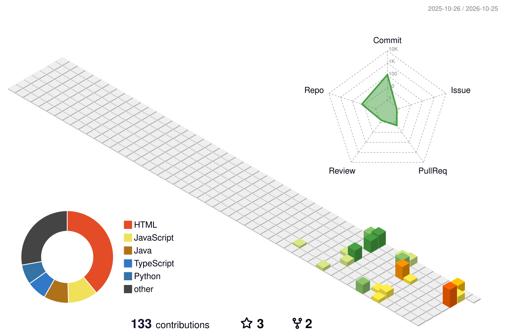

<!-- ==========================================================
     VISHWESHWARAN V. — DEVELOPER PROFILE
     Dark cinematic / Berserk-inspired aesthetic
=========================================================== -->

<div align="center">


<br/>


<br/><br/>

<a href="https://github.com/vishweshwaranbalasundaram">

</a>
<a href="https://www.linkedin.com/in/vishweshwaran-v-448a393a9">

</a>
<a href="https://leetcode.com/u/VISHWESHWARANV/">

</a>

<br/><br/>


</div>

---

## 01 / The Developer Behind the Code

<table>
<tr>
<td width="40%" align="center" valign="middle">


<br/><br/>


<br/>

<sub>STRUGGLE. ENDURE. EVOLVE.</sub>

</td>
<td width="60%" valign="middle">

### `vishweshwaran@github:~$ whoami`

I'm **Vishweshwaran V.**, a Computer Science and Engineering student at Rajalakshmi Engineering College, Chennai.

I'm exploring the world of software engineering, intelligent systems, and creative technology while building practical projects and strengthening my fundamentals.

**CURRENT OBJECTIVES**

- Software Engineering and problem-solving
- Generative AI and Machine Learning
- Full-Stack Web Development
- Data Structures and Algorithms
- Building useful, real-world applications

**MY APPROACH**

Learn the fundamentals. Build things that work. Understand why they work. Keep improving.

</td>
</tr>
</table>

---

## 02 / Technology Arsenal

<div align="center">

**LANGUAGES**


<br/><br/>

**WEB DEVELOPMENT**


<br/><br/>

**DATABASES AND TOOLS**


<br/><br/>


</div>

---

## 03 / Selected Projects

<table>
<tr>
<td width="50%" valign="top">

### Attend-IQ

**Smart Attendance Management System**

An academic project focused on secure attendance workflows, reliable database records, and role-based access.

`Java` `JDBC` `MySQL` `OOP`

[EXPLORE REPOSITORY →](https://github.com/vishweshwaranbalasundaram/Attend-IQ)

</td>
<td width="50%" valign="top">

### HackTrail

**Hackathon Discovery**

A project focused on helping developers discover hackathons and explore opportunities to build and compete.

`Web Development` `Product Design`

[EXPLORE REPOSITORY →](https://github.com/vishweshwaranbalasundaram/hacktrail)

</td>
</tr>
<tr>
<td width="50%" valign="top">

### E-commerce Churn Prediction

**Data Science and Predictive Analytics**

An ML project exploring customer churn prediction and data-driven insights from e-commerce data.

`Python` `Data Science` `Machine Learning`

[EXPLORE REPOSITORY →](https://github.com/vishweshwaranbalasundaram/ecommerce-churn-prediction)

</td>
<td width="50%" valign="top">

### SafePay Guard OS

**Payment Safety Concept**

A project exploring safer payment experiences and software-based protective mechanisms.

`Software Engineering` `Security Concepts`

[EXPLORE REPOSITORY →](https://github.com/vishweshwaranbalasundaram/safepay-guard-os)

</td>
</tr>
</table>

---

## 04 / LeetCode Command Center

<div align="center">

<a href="https://leetcode.com/u/VISHWESHWARANV/">

</a>

<br/><br/>

<a href="https://leetcode.com/u/VISHWESHWARANV/">

</a>

</div>

---

## 05 / Contribution Universe

<div align="center">

<sub>EVERY COMMIT BUILDS THE NEXT LEVEL</sub>

<br/><br/>

<picture>
<source media="(prefers-color-scheme: dark)" srcset="profile-3d-contrib/profile-night-rainbow.svg"/>
<source media="(prefers-color-scheme: light)" srcset="profile-3d-contrib/profile-green.svg"/>

</picture>

<br/><br/>

<sub>CONSISTENCY IS BUILT ONE DAY AT A TIME.</sub>

</div>

---

## 06 / The Commit Trail

<div align="center">

<picture>
<source media="(prefers-color-scheme: dark)" srcset="profile-3d-contrib/profile-night-view.svg"/>
<source media="(prefers-color-scheme: light)" srcset="profile-3d-contrib/profile-season.svg"/>

</picture>

</div>

---


<!-- 07 / BERSERK DEVELOPER CONSOLE -->

<h2 align="left">07 / THE BLACK SWORDSMAN — DEVELOPER CONSOLE</h2>

<div align="center">


<br/>


</div>

<br/>

<div align="center">


</div>

<table>
<tr>
<td width="52%" valign="top">

### `// SYSTEM STATUS`

```text
┌──────────────────────────────┐
│ SUBJECT   : VISHWESHWARAN     │
│ CLASS     : DEVELOPER         │
│ SYSTEM    : ONLINE            │
│ MINDSET   : UNBREAKABLE       │
│ MODE      : CONTINUOUS BUILD  │
└──────────────────────────────┘
```


</td>
<td width="48%" valign="top">

### `// MISSION DIRECTIVES`


</td>
</tr>
</table>

---

<div align="center">

### `// THE STRUGGLE CONTINUES`


<br/>

<sub>EVERY BUG IS A BATTLE. EVERY PROJECT IS PROGRESS.</sub>

<br/><br/>


</div>

---

---


<h2 align="left">08 / Contribution Snake</h2>

<div align="center">
  
</div>

---

---

## 09 / GitHub Analytics

<div align="center">

<a href="https://github.com/vishweshwaranbalasundaram">

</a>

<a href="https://github.com/vishweshwaranbalasundaram">

</a>

<br/><br/>


</div>

---

## 10 / Current Learning Path

<table>
<tr>
<td width="33%" align="center" valign="top">

### SOFTWARE

Programming fundamentals, Java, Python, DSA, and maintainable code.

</td>
<td width="33%" align="center" valign="top">

### INTELLIGENCE

Machine Learning, Generative AI, RAG, and agentic systems.

</td>
<td width="33%" align="center" valign="top">

### ENGINEERING

React, Next.js, backend APIs, databases, and complete applications.

</td>
</tr>
</table>

---

## 11 / Connect

<div align="center">

Interested in software engineering, AI, open source, or building something useful? Let's connect.

<br/><br/>

<a href="https://github.com/vishweshwaranbalasundaram">

</a>
<a href="https://www.linkedin.com/in/vishweshwaran-v-448a393a9">

</a>
<a href="https://leetcode.com/u/VISHWESHWARANV/">

</a>

<br/><br/>

<sub>DESIGNED WITH INTENT · BUILT WITH CURIOSITY · IMPROVED WITH EVERY COMMIT</sub>

<br/><br/>


</div>
