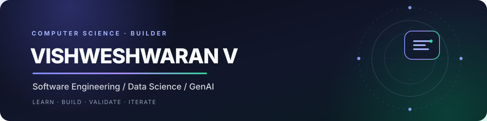
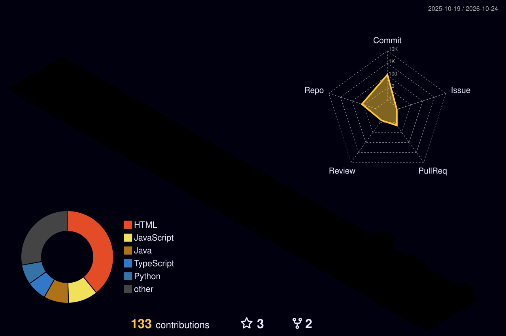
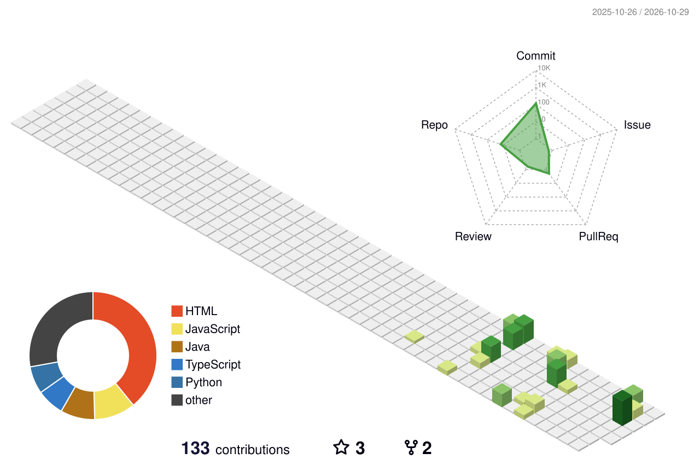

<div align="center">




<br />

<a href="https://www.linkedin.com/in/vishweshwaran-v-448a393a9">
  
</a>
<a href="https://github.com/vishweshwaranbalasundaram">
  
</a>
<a href="https://leetcode.com/u/VISHWESHWARANV/">
  
</a>

</div>

---


## 01 / Meet the Developer

<table>
<tr>
<td width="38%" align="center" valign="middle">


<br />

<strong>VISHWESHWARAN.exe</strong>

<br />

<sub>BUILT THROUGH STRUGGLE. DRIVEN BY PURPOSE.</sub>

</td>
<td width="62%" valign="middle">

### `vishweshwaran@portfolio:~$ ./introduce.sh`


<br />

**CURRENT OBJECTIVE**

Building practical software, strengthening engineering fundamentals, and exploring intelligent systems.

<br />

<code>STATUS: LEARNING / BUILDING / EVOLVING</code>

</td>
</tr>
</table>

> A relentless journey toward becoming better than yesterday.

---

## 02 / Featured Projects

<table>
<tr>
<td width="50%" valign="top">

### Attend-IQ

**Smart Attendance Management System**

A database-backed attendance application focused on students, faculty, class sessions, attendance records, and reliable persistence.

`Java` `JDBC` `MySQL` `OOP` `DBMS`

<a href="https://github.com/vishweshwaranbalasundaram/Attend-IQ">
  
</a>

</td>
<td width="50%" valign="top">

### HackTrail

**Hackathon Discovery Platform**

A web project focused on helping users discover and explore hackathon opportunities.

`Web Development` `UI/UX` `Product Design`

<a href="https://github.com/vishweshwaranbalasundaram/hacktrail">
  
</a>

</td>
</tr>
<tr>
<td width="50%" valign="top">

### E-Commerce Churn Prediction

**Customer Analytics & Machine Learning**

A data science project exploring customer churn prediction and e-commerce behaviour.

`Python` `Data Science` `Machine Learning`

<a href="https://github.com/vishweshwaranbalasundaram/ecommerce-churn-prediction">
  
</a>

</td>
<td width="50%" valign="top">

### SafePay Guard OS

**Payment Safety & Security**

A project exploring safety-oriented concepts for digital payment workflows and transaction protection.

`Software Engineering` `Security` `Application Development`

<a href="https://github.com/vishweshwaranbalasundaram/safepay-guard-os">
  
</a>

</td>
</tr>
</table>

---

## 03 / Technology Stack

**Languages**

<p>
  
</p>

**Frontend & Backend**

<p>
  
</p>

**Databases & Developer Tools**

<p>
  
</p>

**Current focus:** DSA · Machine Learning · Generative AI · Full-Stack Development

---

## 04 / GitHub Analytics

<div align="center">

<a href="https://github.com/vishweshwaranbalasundaram">
  
</a>
<a href="https://github.com/vishweshwaranbalasundaram">
  
</a>

<br /><br />


</div>

---

## 05 / Contribution Universe

<p align="center">
  <sub>MY JOURNEY, ONE CONTRIBUTION AT A TIME</sub>
</p>

<div align="center">



<br />



<br />

<sub>Every commit adds another block to the world I'm building.</sub>

</div>

---

## 06 / The Commit Trail

<p align="center">
  <sub>Consistency over intensity. Progress over perfection.</sub>
</p>

<div align="center">

<picture>
  <source media="(prefers-color-scheme: dark)" srcset="https://raw.githubusercontent.com/vishweshwaranbalasundaram/vishweshwaranbalasundaram/output/github-snake-dark.svg" />
  <source media="(prefers-color-scheme: light)" srcset="https://raw.githubusercontent.com/vishweshwaranbalasundaram/vishweshwaranbalasundaram/output/github-snake.svg" />
  
</picture>

</div>

---

## 07 / LeetCode

<div align="center">

<a href="https://leetcode.com/u/VISHWESHWARANV/">
  
</a>

<br /><br />

<a href="https://leetcode.com/u/VISHWESHWARANV/">
  
</a>

</div>

---

## 08 / Current Learning Path

<table>
<tr>
<td width="33%" align="center">

**Software Engineering**

DSA, problem-solving, Java, backend fundamentals

</td>
<td width="33%" align="center">

**Artificial Intelligence**

Python, statistics, ML fundamentals, Generative AI

</td>
<td width="33%" align="center">

**Full-Stack Development**

TypeScript, React, Next.js, databases, APIs

</td>
</tr>
</table>

---

## 09 / Developer Console

<div align="center">

<table>
<tr>
<td>

```text
vishweshwaran@github:~$ whoami

  Computer Science Student
  Software Engineering Enthusiast

vishweshwaran@github:~$ interests

  > Generative AI
  > Machine Learning
  > Full-Stack Development
  > Data Structures & Algorithms

vishweshwaran@github:~$ mission

  Build useful things.
  Learn how they work.
  Make them better.

vishweshwaran@github:~$ status

  BUILDING / LEARNING / IMPROVING
```

</td>
</tr>
</table>

</div>

---

## 10 / Let's Connect

I'm interested in collaborating on software projects, AI applications, and developer-focused tools.

<div align="center">

<a href="https://www.linkedin.com/in/vishweshwaran-v-448a393a9">
  
</a>
<a href="https://github.com/vishweshwaranbalasundaram">
  
</a>
<a href="https://leetcode.com/u/VISHWESHWARANV/">
  
</a>

<br /><br />

<sub>Designed with purpose. Built through curiosity. Improved with every commit.</sub>

</div>
